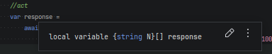

     


# Introduction

## Reference links

- [Hamster Wheel](https://internetexception.com/why-hamster-wheel/)
- [HLinq design](https://internetexception.com/2025/10/28/hlinq-design/)
- [Demo - in memory collection](https://hlinq-demo.podbielski.it/demo/memory)
- [Demo - db collection](https://hlinq-demo.podbielski.it/demo/db)

# What's contained in this project

This project contains of two main parts:
- main package: HamsterWheel.HLinq that main implementation of HTTP Linq resource language
- HamsterWheel.HLinq.Abstractions package that can be used to further develop extensions for HLinq and adding functionalities missing from main package
- HamsterWheel.HLinq.AspNet package contains helpers for HLinq integration with Asp.NET core framework
- HamsterWheel.HLinq.PgSql package with PostgreSql specific functions for use in HLinq queries
- HamsterWheel.HLinq.MySql and HamsterWheel.HLinq.MariaDb packages with the Pomelo provider functions for use in HLinq queries
- HamsterWheel.HLinq.Sqlite package with EF Core SQLite functions for use in HLinq queries
- HamsterWheel.HLinq.Client package with fluent API for building HLinq queries on top of HttpClient


Navigation:
 - [How to use on server](#how-to-use-on-server)
   - [Usage within minimal API](#usage-within-minimal-api)
   - [Usage inside Controller](#usage-inside-controller)
   - [Configuring HLinq inside API](#configuring-hlinq-inside-api)
     - [Default limit of records returned](#default-limit-of-records-returned)
     - [Overriding user requested number of records](#overriding-user-requested-number-of-records)
     - [Adding EF DB Functions](#adding-ef-db-functions)
 - [How to use on the client](#how-to-use-on-the-client)
   - [Syntax](#syntax)
     - [White space management](#white-space-management)
   - [HTTP Queries](#http-queries)
     - [Paging](#paging)
     - [Filtering](#filtering)
       - [Equals](#equals)
       - [Not equals](#not-equals)
       - [Greater](#greater)
       - [Greater or equal](#greater-or-equal)
       - [Lesser](#lesser)
       - [Lesser or equal](#lesser-or-equal)
       - [String contains](#string-contains)
       - [String contains with case-insensitive](#string-contains-with-case-insensitive)
       - [String StartsWith](#string-startswith)
       - [String EndsWith](#string-endswith)
       - [EF DbFunctions](#ef-dbfunctions)
         - [PgSql](#pgsql)
     - [Selecting](#selecting)
     - [Grouping](#grouping)
     - [Ordering](#ordering)
   - [Using the C# client](#using-the-c--client)
 - [Extensions](#extensions)
   - [Translations](#translations)
      - [Using culture in a query](#using-culture-in-a-query)
      - [Custom keywords](#custom-keywords)
   - [Custom filters](#custom-filters)
 - [Dynamic object transformation]
 - [Roadmap](#roadmap)

# How to use on server

Below you can find instructions how to get you started using HLinq on the server using HamsterWheel.HLinq.AspNet package.

## Usage within minimal API

First, reference AspNet package:
```xml
<PackageReference Include="HamsterWheel.HLinq.AspNet" Version="0.13.0" />
```

After that add initialization of HLinq:
```csharp
services.ConfigureHLinq();
```

To actually make it useful you need to add it to the endpoint. In example if you fetch data from the database in this way:
```csharp
app.MapGet("/endpoint",
    (DbContext dbContext, CancellationToken cancellationToken) =>
    {
        return dbContext.MySet.Take(10).ToArrayAsync(cancellationToken);
    });
```

You need to add `HLinqQuery<MyEntity>` model into your endpoint which is actual HLinq query mapped from HTTP Query String into type safe structure. `MyEntity` type is important to be the actual type your API exposes to the clients. 

So in above example it will become:
```csharp
app.MapGet("/endpoint",
    (DbContext dbContext, HLinqQuery<Superhero> query, CancellationToken cancellationToken) =>
    {
        var queryable = dbContext.MySet; 
        return query.ApplyTo(queryable, cancellationToken);
    });
```

And that is it!
You can now call this endpoint with HLinq query filters, ordering, paging and selects!

## Usage inside Controller

If you do not use minimal APIs of Asp.Net Core you can use HLinq within controllers too.
First you need to install package and configure it inside the host. Those are similar steps.


Reference AspNet package:
```xml
<PackageReference Include="HamsterWheel.HLinq.AspNet" Version="0.13.0" />
```

Initialize HLinq:
```csharp
services.ConfigureHLinq();
```

Then you must add `HLinqQuery<MyEntity>` into your endpoint method:
```csharp
[HttpGet("my-endpoint")]
public IActionResult GetData(HLinqQuery<MyEntity> query, CancellationToken cancellationToken) =>
    Ok(query.ApplyTo(dbContext.MySet, cancellationToken));
```
And that is all. Very similar to minimal APIs and also very simple.

## Configuring HLinq inside API

### Default limit of records returned
If you are using HLinq entirely within bounds of one application, there is no default limit of how many records you will fetch. And it is not really a problem. You can do that too with just Linq to SQL, i.e. call `ToArray` or `ToList` on entire DB collection. But on the API side you do not really have control on what yours users will do and calling and API endpoint without any query modifiers, me personally it is first thing I do, just to see what kind of result it will return, with what information. Since HLinq requires `skip[].take[]` to be provided this would cause entire data to be serialized and sent to the client. At once. This would be very problematic. Of course this is also not desired by 99% of cases. To fix this HLinq limits records returned to maximum value of 1k. If you do not like the default limit you can change it:
```csharp
builder.Services.ConfigureHLinq(c => c.HLinqOptions.HttpDefaultMaxTakeRecords = 100);
```
This will limit number of records returned by default to 100. 

### Overriding user requested number of records
If a user is trying to fetch a huge quantity of data from the API by specifing i.e. `take[1000000]`, this may overload your db and API server(s). To remedy this, HLinq is overriding those values with `IHLinqOptions.HttpDefaultMaxTakeRecords` value. If you want to specify a different value for that case change this inside `ConfigureHLinq` method:
```csharp
builder.Services.ConfigureHLinq(c => c.HLinqOptions.HttpDefaultMaxTakeRecords = 100);
```

### Adding EF DB Functions
In Linq you can use DB functions from inside the C# code. Those functions are not evaluated on the .net side but translated in SQL and evaluated by the DB engine. HLinq allows you to use them, but it is not aware of your environment.
To tell HLinq about your DB capabilities, you need to configure it inside `ConfigureHLinq` method call.
For example, the following lines add the functions of a database to HLinq:
```csharp
services.ConfigureHLinq(c => c.AddPgSqlToHLinq());     // HamsterWheel.HLinq.PgSql
services.ConfigureHLinq(c => c.AddSqlServerToHLinq()); // HamsterWheel.HLinq.SqlServer
services.ConfigureHLinq(c => c.AddMySqlToHLinq());     // HamsterWheel.HLinq.MySql
services.ConfigureHLinq(c => c.AddMariaDbToHLinq());   // HamsterWheel.HLinq.MariaDb
services.ConfigureHLinq(c => c.AddSqliteToHLinq());    // HamsterWheel.HLinq.Sqlite
```
A function returning bool is enough to filter on its own - `where[ILike(x.Name, %Bill%)]`, `where[IsDate(x.Name)]`
A function answering with another type need to be compared with another value to be used in filter:
- `where[DateDiffDay(x.From, x.To) > 7]`
- `where[Reverse(x.Name) == ylliB]`

You can use any property in such function, any number, any text, a single character, the member of an enum. As long at parameters type matches. HLinq will try its best to match them but it cannot convert "foobar" to `int`.

Details of all available functions for each engine are here: [Db Functions Filters](docs/db-functions/README.md), [Postgres](docs/db-functions/postgres.md), [SQL Server](docs/db-functions/sql-server.md), [MySQL](docs/db-functions/mysql.md), [MariaDB](docs/db-functions/mariadb.md), [SQLite](docs/db-functions/sqlite.md). A pack is the list of what one database can do, not a promise about what a query may ask: a function its provider cannot translate fails at the database, as the same call written by hand in Linq does.

# How to use on the client

HLinq have a client that allows you to build HLinq queries in a more type safe manner using `Expression`s syntax of Linq. Not full Linq is supported in HLinq (mostly because limited support of URLs characters), but many of filtering methods, ordering, selects, skip, take directives are possible.
Using any specific client is not required, though. You can use any HTTP client with Query String support.

## Syntax

HLinq syntax is very similar to Linq syntax. It contains roots, that are equivalent to Linq methods (like `Where`, `Select`, `OrderBy`, `Skip`, `Take`) which are parametrized by providing `[]` with appropriate arguments values. 
Supported roots are:
- `where`
- `select`
- `skip`
- `take`
- `count`
- `orderBy`
- `orderByDescending`
- `thenBy`
- `thenByDescending`

Roots are chained together using `.` character. For example:
```http request
GET /data?where[x.Name==John].skip[10].take[20].select[fullName=x.Name]
```

Casing in root names is not important. For example, `WHERE` and `where` are equivalent. Or example even `wHeRe` is valid to harder to read.

Roots order matters. For example, if you are querying `Person` type that have `FirstName` property, querying the API with `where[x.firstName==John].select[name=x.firstName]` will first filter the collection selecting all the persons with `firstName` being `John` and then will select only `firstName` property as new `name` property. Resulting json will be:
```json
[
  {
    "name": "John"
  }
]
```
On the other hand, when you will query API with `select[name=x.firstName].where[x.firstName==John]` query will return an error.
```json
{
  "title": "Invalid property path 'firstName' for entity 'DynamicAnonymousType0`1'. Available properties at this point are: name ",
  "status": 400
}
```
This is because `firstName` is property of `Person` type, but when you applying `select[name=x.firstName]` you are effectively changing `IQueryable` to being a collection of new type. C# equivalent of this query would be:
```csharp
personQueryable.Select(x => new { Name = x.FirstName });
```
As you can see, `FirstName` does not exist in a queryable collection anymore.

Parameters of roots depend on the root. 

For example, `count` root does not take any parameters. The only valid usage is `count[]`.

`take` and `skip` roots single number as a parameter (i.e. `take[10]`, `skip[20]`).

`take` root additionally accepts a range of rows (i.e. `take[10..20]`). See [Paging](#paging).

`orderBy` and `orderByDescending` roots take a single parameter, which is a property name to order by.

`select` root takes unspecified number of parameters, separated by `,`, parameters with two variants:
- `select[x.name]` selects property as is
- `select[newName=x.name]` renames selected property.

`select` allow to select as many properties with both. The order of properties or renames is not important.

`where` root also takes unspecified number of parameters. Parameters are separated by `,`. Syntax depends on the following:
- type of property
- comparison operator or comparison method
- value you are comparing to

For example, when you are comparing to constant value:
```http request
GET /data?where[x.{property name}{operator}{constant value}]
```
But if you want to filter a property containing a specific value:
```http request
GET /data?where[x.{property name}.Contains({constant value})]
```
The same can be achieved with an EF method call:
```http request
GET /data?where[ilike(x.{property name},{constant value})]
```
or the same can be achieved with `string.Contains(property, StringComparison.InvariantCultureIgnoreCase)` (or similar instance of a property type) method:
```http request
GET /data?where[x.{property name}.{property type method}({constant value},{constant argument})]
```
Constant value within where parameters can be almost any value. How it is treated depends on the type of the property. I.e. `int` will be converted to `int` before comparison. String will not be converted and will be taken as is from Query String. 

It is possible to use () in `where`. This effectively allows grouping of conditions. For example 
```http request
GET /data?where[(x.Id==1||x.Name.StartsWith(d))&&x.DateOfBith>=2010-08-31 00:00]
```
will return either record with Id=1 or records with Name starting with `d` when date of birth is after 2010-08-31 00:00.
But
```http request
GET /data?where[x.Id==1||x.Name.StartsWith(d)&&x.DateOfBith>=2010-08-31 00:00]
```
will return either with Id=1 OR records with Name starting with `d` AND date of birth is after 2010-08-31 00:00.
This works the same as in Linq.

Constant values do not need to be quoted. If you are looking for a person with their full name, put space in a string between first and last name:
```http request
GET /data?where[x.firstName==John Doe]
```

A value that holds a character the query language itself uses - `,`, `]`, `(`, `==`, `..` - is written in double quotes, and then everything between them is the value:
```http request
GET /data?where[x.Name==Kowalski, Jan]            // `,` ends a value, so this is not one query
GET /data?where[x.Name=="Kowalski, Jan"]          // one value: Kowalski, Jan
GET /data?select[FullName="Kowalski, Jan",x.Id]   // the comma in quotes is text, the next one ends the list item
```

Quotes can be used for values. Property name can never hold a comma or a space, because a C# identifier cannot - HLinq uses the same rules.
Quotes does not change type of value. A quoted value is cast to the type it is compared to:

```http request
GET /data?where[x.Int==5]                     // five
GET /data?where[x.Int=="5"]                   // also five
GET /data?where[x.Date>="2020-01-01 00:00"]   // a date and time, the space being a character of the value
```

The one word quotes do change is `null`: unquoted it is nothing, quoted it is the text n-u-l-l.

```http request
GET /data?where[x.Name==null]        // records with no name
GET /data?where[x.Name=="null"]      // records whose name is the word "null"
```

There is no escape character in HLinq currently. If your value that *starts* with `"` is quoted and ends on another element of the HLinq language like `]` or `||`.
So if you want to search for some text including special characters:

```csharp
where[x.Name=="John Braces]"]   -> value: John Braces]
where[x.Name=="a]b"]            -> value: a]b 
where[x.Name=="Rock""&&x.Id==1] -> value: Rock"
where[x.Name=="Rock""]          -> value: Rock"
```

HLinq only finishes value when it is outside of quotes and there is another keyword that is part of grammar. It means that quoting works and treats everything inside as part of the value. Ending of this value is not first `"` but `"]` or `"&` or similar part of grammar.

### Members resolution

Query root keywords does not matter. The same applies to property names, though JSON property names are preferred. So for example `x.firstName` is preferred when `x.FirstName` is also possible and it is a valid CLR property name.

A name that several members of the type match is decided by HLinq based on how much of an effort it will take to use it.
If the members can be bound at all?
How hard is to convert query value to given type?
How far is the name in the query from the actual name of member?
Is it declared in entity type? Or inherited?
If it is still ambigous an ordinal comparison decides.

A type with both `Name` and `name` therefore answers `x.Name` with `Name` and `x.name` with `name` on every query, and a method overload taking an argument as the query wrote it wins over one that would have to convert it.

If HLinq had to choose between two members, it will try to warn user that it was not clear from the query what should be used:

```http request
GET /demo/sidekicks?where[x.name==Bucky]

HTTP/1.1 200 OK
X-HLinq-Warning: reason="ambiguous-name", member="NAME", type="HamsterWheel.HLinq.Demo.Data.Sidekick", competitors="NAME, Name", query="where[x.name==Bucky]"
```

For properties it is `ambiguous-name` and `ambiguous-call` when two overloads being possible with the same arguments. `member` is name of member that was used to produce response. `competitors` is list of ambigous members. `type` the type the members belong to, and `query` the query as it was written.
The header is a hint and nothing more. HLinq still answer with HTTP 200 OK. Also warnings stops at five lines, a sixth saying `more="true"` when the query was ambiguous about more members - rest is sent to the log. 
If you want to disable warnings you can do so:

```csharp
builder.Services.AddOpenApi()
    .ConfigureHLinq(c => c.HLinqOptions.EmitWarnings = false);
```

If you want to store warnings in your logs instead of sending them in HTTP header to the client you can do so:

```csharp
app.MapGet("/demo/sidekicks", (HLinqQuery<Sidekick> query, CancellationToken cancellationToken) =>
{
    var sidekicks = query.ApplyTo(Sidekick.Sidekicks.AsQueryable(), cancellationToken);

    foreach (var warning in query.Warnings.Reported)
    {
        logger.LogWarning("HLinq chose {Member} of {Type} of {Competitors}", warning.Member, warning.Type,
            string.Join(", ", warning.Competitors));
    }

    return sidekicks;
});
```

### White space management

White space is not important in HLinq. You can almost use any white space you want. It is mostly ignored by the parser, except for constant values provided by the user. 
For example, leading or trailing white space before or after the root is allowed.
```csharp
"    orderBy[x.Name]          "
```
You can put white space between root and `[` character:
```csharp
"orderBy  [x.Name]"
```
Only space is allowed, but other white space characters are allowed also.
For example:
```csharp
"orderBy[x\r\n.Name]"
```
This means that for longer queries you can use new lines to make it more readable.
```csharp
"""
orderBy[x.Name]
    .skip[10]
    .take[100]
"""
```

## HTTP Queries
Lets use demo endpoint `/demo/memory` that returns `SuperHero` type data.

```http request
GET /demo/memory
```
returns data as is, which one exception being the maximum limit of records returned (by default 1k).

### Parameters of the request

A request carries the clauses and the parameters of the endpoint in one query string. The parameters go out before HLinq reads it - `page`, `sort`, whatever the endpoint binds with `[FromQuery]` - HLinq neither applies them nor complains about them:
```http request
GET /demo/memory?page=2&where[x.Name==Superman]&sort=asc      OK, filters
GET /demo/memory?page=2                                        OK, everything: no clause was asked
```
HLinq reads one parameter of its own: the culture. It is read from the request, so where it stood says nothing - a query is interpreted with one culture, whether the request named it before the clauses or after them - and the value is taken as the request wrote it, `pl` as readily as `pl-PL`:
```http request
GET /demo/memory?culture=pl-PL&where[x.Name==Superman]
GET /demo/memory?where[x.Name==Superman].take[10]&culture=pl
```
A request that names the parameter several times is read as its first value and the rest are ignored. The word itself is replaceable per language, the way the keywords of a localized grammar are - `format=pl-PL`, `konwersja=pl-PL` - by registering an `ICultureParameterKeyword`.

What is left in the string after the parameters are out has to be a query, and a bracket belongs to the query: `?wher[x.Name==Superman]&page=2` is refused instead of handing back the whole collection, and a clause cannot be dropped behind a parameter:
```http request
GET /demo/memory?where[x.Name==Superman].take[10]                   OK
GET /demo/memory?where[x.Name==Superman]&take[10]                   error, `&` does not join clauses
GET /demo/memory?where[x.Name==Superman]&culture=pl&take[10]        error, take is not dropped
```
The query language itself has no parameters, HLinq's own included: the tokenizer is handed the query alone, and `culture=pl-PL&where[x.Name==Superman]` is not a query to it. An `&` inside a clause - quoted or not - belongs to the clause and never splits it; a `%26` is a character of a value, not a separator.

### Setting query culture

It is possible to user to set query culture. By default query is interpreted with `CultureInfo.InvariantCulture`. If you want HLinq to interpret values differently you need to set it explicitly to different value:

```http request
GET /demo/random?where[x.Decimal>"1,2"]                   twelve: here a comma groups thousands
GET /demo/random?culture=pl-PL&where[x.Decimal>"1,2"]     one and a fraction: there a comma is where the fraction starts
```
The same value is interpreted differently depending on query culture and it changes returned collection.

HLinq does not limit number of supported cultures. If .net allows you to use one, HLinq too. `pl`, `pl-PL`, `de`, `en-GB` - all works as long as it is recongnized by .net.
Of course invalid values does not work. `culture=test` is invalid and HTTP 400 is returned. 

On the other hand if your runtime does not allow globalization (`InvariantGlobalization`), HLinq will refuse such queries entirelly.

If `culture` is set by the user and HLinq is configured with translation - it is possible to use translated keywords inside the query.
Keywords of the language - `where`, `select`, `take` can be localized and query will realize the same.
On the other hand `null` keyword, the entity `x` - do not have their translations at all. You can refer to [Translations](#translations) for details.

### Paging

Adding `take[10]` instructs HLinq to return only 10 records.
```http request
GET /demo/memory?take[10]
```

Adding `skip[20].take[10]` instructs HLinq to return only 10 records after skipping first 20 records.
```http request
GET /demo/memory?skip[20].take[10]
```

This allows for simple and expressive paging of data on the client side. I.e., if the default page size is 10 rows, call the endpoint with:
```csharp
await httpClient.GetAsync($"/demo/memory?skip[{pageSize*page}].take[{pageSize}]");
```

The `take` root also accepts a range of rows, `take[start..end]`, which is a sugar for `skip[start].take[end-start]` (the C# `Range` semantics).
```http request
GET /demo/memory?take[10..20]
```
returns the same 10 rows (indices 10-19) as `skip[10].take[10]`. Both ends are optional:
- `take[10..]` means everything after the first 10 rows (like a bare `skip[10]`, not capped at the maximum take),
- `take[..20]` means the first 20 rows (like `take[20]`).

`take[..]` takes nothing and expresses nothing, so it is invalid, and so are ranges with a negative side or with `start` not smaller than `end` (i.e. `take[10..2]`). The maximum take cap applies to the number of rows taken (`end - start`), the skipped part is never capped.

The HLinq client builder has a matching `Take(Range)` overload:
```csharp
var superheroes = await httpClient.GetWithHLinq("/demo/memory", q => q.For<Superhero>().Take(10..20));
```

To count total number of records in the collection you are querying you need to use `count[]` root.
```http request
GET /demo/memory?count[]
```

Count can be applied after filtering (or any other root for that matter) to get only the number of records in a filtered collection instead.
```http request
GET /demo/memory?where[x.name.contains(Ant)].count[]
```
This will give you the number of records in the collection that have `name` property containing `Ant` value.

### Filtering

There are various filters possible in HLinq:
- equals
- not equals
- greater
- greater or equal
- lesser
- lesser or equal
- string contains (with case-insensitive variant) - usually not supported by DB
- string starts with (with case-insensitive variant) - usually not supported by DB
- string ends with (with case-insensitive variant) - usually not supported by DB
- EF DbFunctions

If this is not enough, you can write your own extension to support new operators or functions.

#### Equals
In example to look for entity with specific Id:
```http request
GET /data?where[x.Id==1]
```
```http request
GET /data?where[x.Id==77774169-BB9D-4DF9-A4A7-52019C4A445D]
```
```http request
GET /data?where[x.Name==John]
```
```http request
GET /data?where[x.Name==John Smith]
```
Notice double `=` sign in comparison. It is consistent with how Linq works in C# - a single `=` never compares, it renames, and only inside `select[...]` (`select[NewName=x.Property]`).

The compared value can stand on either side of the operator, so both of these are the same query:
```http request
GET /data?where[x.Id==1]
```
```http request
GET /data?where[1==x.Id]
```
Comparison keeps the order it was written in, nothing is flipped behind your back: `where[10<x.Int]` selects entities with `Int` greater than `10`.

Both sides of a comparison can be properties - a side starting with the entity letter is a path, anything else is the value to compare with:
```http request
GET /data?where[x.Password==x.PasswordRepeat]
```
The two properties have to be comparable with each other, `where[x.Name==x.Id]` reports that they are not.

To filter by records that do not have value use null keyword:
```http request
GET /data?where[x.Name==null]
```

To filter by floating point numeric you can use `.` delimiter for fractions. It is consistent with `CultureInfo.InvariantCulture` numerical format, which is the default culture for a query.
`.` separates the fraction, `,` groups thousands, so a `1,2` reaching a `decimal` is twelve - in another culture the same characters may be read as different value (1.2 in Polish)
If you want to use different format for numeric values or dates [a request can specify different culture](#using-culture-in-a-query).
```http request
GET /data?where[x.Number==1.2323]
```
Numbers can also have white space around it (` 5 `) or have a sign on either side (`5-`)
It is also allowed for the floating point types an be in exponent format (`1e3`).
A currency symbol and a parenthesised negative numbers (i.e. `where[x.Number==(5)]` is not allowed
.
HLinq does not apply any precision for equality comparison, so due to floating point rounding errors you may get different results. To fix this you can use two values with `>` and `<` operators.
```http request
GET /data?where[x.Number>1.2322&&x.Number<1.2324]
```

For Date Time and Date Time Offset types you can use ISO 8601 format:
```http request
GET /data?where[x.DateOfBirth==2025-10-05T19:43:07.3693705Z]
```
Or with the time zone part:
```http request
GET /data?where[x.Modified==2025-10-05T19:44:10.8405723+00:00]
```
Equals can be used inside a group as any other filtering condition:
```http request
GET /data?where[(x.Name==John||x.Name==Doe)]
```

#### Not equals
Usage is the same as for equals, but with `!=` operator.
```http request
GET /data?where[x.Id!=1]
### OR
GET /data?where[x.Id!=77774169-BB9D-4DF9-A4A7-52019C4A445D]
```
Not equals comparison operator is `!=` which is consistent with C# syntax of Linq.

#### Greater
Usage is the same as for equals, but with `>` operator.
```http request
GET /data?where[x.Id>1]
```

#### Greater or equal
Usage is the same as for equals, but with `>=` operator.
```http request
GET /data?where[x.Int>=1]
```

#### Lesser
Usage is the same as for equals, but with `<` operator.
```http request
GET /data?where[x.Int<1]
```

#### Lesser or equal
Usage is the same as for equals, but with `<=` operator.
```http request
GET /data?where[x.Int<=1]
```

#### String contains
Testing for string contents is a bit different but still resembles Linq syntax. 
```csharp
queryable.Where(x => x.Name.Contains("John"));
```
In HLinq you have to query it like below instead:
```http request
GET /data?where[x.Name.Contains(John)]
```
You can use the white space in the string:
```http request
GET /data?where[x.Name.Contains(John Doe)]
```

#### String contains with case-insensitive
> [!WARNING]  
> Though this is supported by HLinq and Linq, it is not supported by EF. Use it for memory collections only. 

Of course usage of `string.Contains` is consistent with Linq and is case-sensitive.
To use a case-insensitive version, you need to add an extra parameter just like in C#:
```http request
GET /data?where[x.Name.Contains(John, StringComparison.InvariantCultureIgnoreCase)]
```
Also, it is possible to use DB functions in case-insensitive searches:
```http request
GET /data?where[ilike(x.Name, n)]
```
This is equivalent of a Linq query:
```csharp
queryable.Where(x => x.Name.Contains("n", StringComparison.InvariantCultureIgnoreCase));
```

#### String StartsWith
> [!WARNING]  
> Though this is supported by HLinq and Linq, it is not supported by EF. Use it for memory collections only.

In the same manner as `Contains` can be used `StartsWith` method:
```http request
GET /data?where[x.Name.StartsWith(John)]
```
To use a case-insensitive version, you need to add an extra parameter just like in C#:
```http request
GET /data?where[x.Name.StartsWith(John, StringComparison.InvariantCultureIgnoreCase)]
```

#### String EndsWith
> [!WARNING]  
> Though this is supported by HLinq and Linq, it is not supported by EF. Use it for memory collections only.

In the same manner as `Contains` and `StartsWith` can be used `EndsWith` method:
```http request
GET /data?where[x.Name.EndsWith(n)]
```
To use a case-insensitive version, you need to add an extra parameter just like in C#:
```http request
GET /data?where[x.Name.EndsWith(John, StringComparison.InvariantCultureIgnoreCase)]
```

#### EF DbFunctions
> [!WARNING]  
> Support for those functions vary between DB engines and their EF providers. Check which ones are by your DB engine and EF.

> [!WARNING]  
> This is supported by HLinq and Linq and EF but cannot be used on memory collections. Use it for DB collections only.

##### PGSQL
###### ILike
This is very similar to `string.Contains(str, StringComparison.InvariantCultureIgnoreCase)` but instead of using .net runtime function it is translated to db function, and it is applied by DB engine.
For example:
```http request
GET /demo/db?where[ilike(x.NAME, John Doe)]
```
This is equivalent of a Linq query:
```csharp
queryable.Where(x => EF.Functions.ILike(x.Name, "John Doe"));
```

###### ILike with escape character
Very similar to regular ILike but allows for a third argument: escape character.
```http request
GET /demo/db?where[ilike(x.firstName, arlan, \)]
```

This is equivalent of a Linq query:
```csharp
queryable.Where(x => EF.Functions.ILike(x.Name, "John Doe", "\\"));
```

### Selecting
Selecting is used to specify which properties should be returned to the client. It is done by specifying a comma-separated list of property names after the `select` keyword. It is possible to rename properties by specifying new name with `newName=propertyName` syntax.
For example:
```http request
GET /data/persons?select[x.Name,x.Age]
```

This is equivalent of a Linq query:
```csharp
personQueryable.Select(x => new { x.Name, x.Age });
```

This will return only `Name` and `Age` properties of each person only.

If you want to rename `Name` property to `FullName` then you do:
```http request
GET /data/persons?select[fullName=x.name,x.age]
```

This, in turn, usually translates to a Linq query as follows:
```csharp
personQueryable.Select(x => new { FullName = x.Name, x.Age });
```

There is possibility to add constant value to the property:
```http request
GET /demo/memory?select[Name=1]
```
It can be useful when real property was filtered by select, but a client requires it, i.e., for serialization. It can be also used to achieve compatibility on the client when a server data model is changed without changing the actual code.

A constant becomes a `string`, a number or a `bool`. Its type is decided by the way it is written: `Name=1` is a number, `Name=x` and `Name="x"` are text. That is all JSON has - there is no date in it, so `select[Date=2023-10-12]` answers with the text `2023-10-12`. If you need different type your client need to do a convertion.

HLinq creates a new type on the fly to be serialized to JSON and returns it to the client. This means that other properties of the original type are not returned.
Selecting is not an exclusive operation. You need to be specific by providing which properties you are interested in. You cannot exclude properties by excluding them from the query.

### Grouping

Grouping can be used to group rows under by one (or more) properties into collections that share the same value for particular property. 
It is done by the `groupBy` root followed by a comma-separated list of property names - the key:
```http request
GET /data/persons?groupBy[x.Status]
```
This answers a list of `{Key, Rows}` entries, one per group:
```json
[ { "Key": "New", "Rows": [ {"id": 1, ...}, {"id": 2, ...} ] },
  { "Key": "Paid", "Rows": [ {"id": 3, ...} ] } ]
```
Key of such group is the exact value of the property as returned from endpoint without doing any grouping at all.

A `select` written directly after the `groupBy` names the shape of the rows under each key with one special property being the group key: `x.Key`:
```http request
GET /data/persons?groupBy[x.Status].select[x.Name]
```
answers `[{"Key": "New", "Rows": ["Ann", "Bob"]}, {"Key": "Paid", "Rows": ["Cat"]}]`, and `select[x.Key,x.Name]` repeats the key beside each row.
Like any other member the key can be renamed: `select[MyKey=x.Key,x.Name]`. 

If your entity already have `Key` or `key` property, without grouping, it will be hidden by the group key in `select` after `groupBy`. If you need to do further transformation with both properties, you need to rename your `key`:

```http request
GET /demo/memory?select[nyKey=x.key].groupBy[x.Status].select[x.key,x.myKey]
```
This will allow to row inside the grouping to have both properties: original `key` and group `key`.

`take`, `skip`, `orderBy`, `where` and `count` written after a `groupBy` work on groups: 
- `take[2]` keeps two groups
- `count[]` answers how many groups there are.

Only the key orders or filters groups (`orderBy[x.Key]`, `where[x.Key==Paid]`) is allowed.
The rows of a group cannot be ordered or filtered by HLinq. This is DB engines limitation.
If you need to have special ordering or filtering of rows inside the groups do that before the grouping.

A composite key (`groupBy[x.Vendor,x.Status]`) groups by several properties at once - the answer is the same list of entries, with a key of several parts.

A second `groupBy` groups the rows of every group, so the result holds groups under groups:
```http request
GET /data/persons?groupBy[x.Status].groupBy[x.Type]
```
returns `[{"Key": "New", "Rows": [{"Key": "A", "Rows": ["Ann"]}, {"Key": "B", "Rows": ["Bob"]}]}]`. A `select` after a `groupBy` selects columns of the last group. `take`, `where`, `orderBy` and `count` work on the first group.

This is equivalent of a Linq query:
```csharp
personQueryable.GroupBy(x => x.Status)
    .Select(g => new { Key = g.Key, Rows = g.Select(r => r.Name).ToList() });
```

### Ordering
If you need to fetch data in a specific order, you can use `orderBy` and `orderByDescending` roots.
This orders a collection by `Name` property in ascending order:
```http request
GET /demo/memory?orderBy[x.Name]
```
There reverse order use `orderByDescending` root instead.
```http request
GET /demo/memory?orderByDescending[x.Name]
```
It is possible to order by more than one property at a time.
To do this use any number of `thanBy` or `thanByDescending` roots after `orderBy` or `orderByDescending` roots.
```http request
GET /demo/memory?orderBy[x.Name].thenBy[x.realName]
```

## Using the C # client

HLinq have dedicated C# client built on top of `HttpClient` class. It is available in the `HLinq.Client` package.
To use it, you need to create an instance of this `HttpClient` with all the necessary configurations: your API url, authentication, retry policies, etc.
In case of the demo project it can be done as follows:
```csharp
var client = new HttpClient();
client.BaseAddress = new Uri("http://localhost:5000");
```
Then you can call an extension method that allows you to build HLinq GET query with Linq syntax:
```csharp
var result = client.GetWithHLinq("/demo/db", q => q.For<Person>().Count());
```
The first argument is the path to the endpoint you want to call.
The Second argument is the Linq expression that will be translated to HLinq query.

In the above example it will be translated into:
```http request
GET http://localhost:5000/demo/db?count[]
```
Noticed that value of the `result` variable is an `int`. This is because the builder expression returns an int type. If a builder query returns a collection or any other type, `GetWithHLinq` will automatically deserialize server JSON response into that type.

If you change the type by doing a custom select operation, the return type will be changed accordingly.
```csharp
var response = await fixture.Client.GetWithHLinq("/demo/db", q => q.For<Person>().Select(x => x.FirstName).Take(100));
```
The above query will return an array of strings.
On the other hand, if you will ask for custom select which require anonymous type:
```csharp
var response = await fixture.Client.GetWithHLinq("/demo/db", 
    q => q.For<Person>().Select(x => new { N = x.FirstName }).Take(100));
```
JSON response will be deserialized into an array of those objects with single `N` property of a type of string.



The serialization is done by `System.Text.Json` library with default settings of `JsonSerializerDefaults.Web`.
If you do not like default serialization rules, you can change them by providing your own `JsonSerializerOptions` instance to the builder factory `For` method.
```csharp
var response = await fixture.Client.GetWithHLinq("/demo/db", q => q
    .For<Person>(new JsonSerializerOptions())
    .Where(x => EF.Functions.ILike(x.FirstName, "Bill")));
```

A grouping is built with `GroupBy`. It returns and deserialises the list of `Group(Key, Rows)` entries the server sends:
```csharp
var response = await fixture.Client.GetWithHLinq("/demo/db",
    q => q.For<Person>().GroupBy(x => x.LastName).Select(x => x.FirstName).Take(100));
```
The result is a `List<Group<string, string>>` - groups of people first names that shares the same last name.
What the grouping builder answers - `Take`, `Skip`, `Count` - works on groups; `OrderByKey` and `WhereKey` order and filter them by their key.

HLinq client can log HLinq warnings to your application log sink. This is the case ambigous members, that could not decided by the query alone - HLinq engine had to decide.
Those warnings are transported by HTTP header (`X-HLinq-Warning` ). This can be logged by HLinq client if it is handed logger object to `GetWithHLinq` method, automatically.
This ways your application will be aware of those issues transported along the response.
```csharpd
var superheroes = await client.GetWithHLinq("/demo/memory", q => q.For<Superhero>(), logger);
```

# Extensions

HLinq architecture allows for easy extension of many aspects of the library.
HLinq is designed around interfaces retrieved from DI container. If you do not like default behavior, you can provide your own implementations of those interfaces. Just be careful! You might break something :)

## Translations

It is possible to translate HLinq queries to your own language. It is done by registering services for translated keywords:

```csharp
builder.Services.ConfigureHLinq(c =>
{
    c.Extensions.AddTranslatedKeyword<Where>("pl", "gdzie");
    c.Extensions.AddTranslatedKeyword<Select>("pl", "wybierz");
    c.Extensions.AddTranslatedKeyword<OrderByDescending>("pl", "sortujPoMalejaco");
});
```

Words are registered per culture as first parameter of `AddTranslatedKeyword` method.

Some cultures, have predefined packages that bundles already translated keywords. In example my own native Polish language:
```csharp
builder.Services.ConfigureHLinq(c => c.AddPolishToHLinq());
```

`HamsterWheel.HLinq.Lang.Pl` enables to use Polish keywords: `gdzie`, `wybierz`, `grupujPo`, `wez`, `pomin`, `zlicz`, `sortujPo`,
`sortujPoMalejaco`, `potemPo`, `potemPoMalejaco`. Important: without diacritics, because keyword can have only one representation in each language. Also query in a browser encodes most of the characters and `wez` is more readable then `we%C5%BA` of encoded `weź` word. 
Some of keywords are deliberately not translatable. I.e.: `null`. If you want to change it implement your own `INullKeyword` interface.

### Using culture in a query

User can specify what culture should be used for specific query using `culture=pl`. This enables system to recognize translated keywords *and* specify which numeric and dates format should be used.
For example:

```http request
GET /demo/db?culture=pl&gdzie[x.firstName==Nolan]     OK
GET /demo/db?culture=pl&where[x.firstName==Nolan]     OK - the same endpoint answers both
GET /demo/db?gdzie[x.firstName==Nolan]                400 - no culture named, so the invariant words
```

Important to note is that you cannot mix keywords from multiple languages. You can use in single query:
- invariant laguage only, which is English really, when no "culture" parameter is specified
- your own laguage *AND* invariant, when "culture" is specified

A keyword is matched case-insensitively: `gdzie[x.Name=Jan]` and `Gdzie[x.Naem=Jan]` is the same query.
Even the alias of the entity is a keyword: registering `AddTranslatedKeyword<Entity>("pl", "towar")` is possible and then you can use it in a query `gdzie[towar.firstName==Nolan]`.

The `culture` query parameter itself is not possible to be translated.

### Custom keywords

Each HLinq keyword can be replaced by whatever you like. Just put it in the container like any other
service:

```csharp
public class SelectWord()
    : TokenWord<Select>("wybierz", CultureInfo.GetCultureInfo("pl"));

services.ConfigureHLinq(c => c.Extensions.AddWord<SelectWord>());
```

If you want to override generic keyword like `select`. Use `InvariantCulture` instead.

```csharp
public class SelectWord() : TokenWord<Select>("s", CultureInfo.InvariantCulture);
```

```http request
GET /demo/db?wybierz[x.Name]
```
```http request
GET /demo/db?s[x.Name]
```

To replace the word instead of localizing it, overwrite it - and `select[x.Name]` becomes an error:

```csharp
services.ConfigureHLinq(c => c.Extensions.OverWriteWord<SelectWord, Select>());
```
```json
{
  "title": "HLinq query 'select[x.Name]' is invalid and not finished properly.",
  "status": 400
}
```

A word needs no letters, and a translation does not have to be a word: for sorting you may choose the
arrows themselves, `↓` for `orderByDescending` and `↑` for `orderBy`.

```csharp
public class DescendingWord() : TokenWord<OrderByDescending>("↓");
```
```http request
GET /demo/db?↓[x.firstName]
```

## Custom filters

It is also possible to extend HLinq by writing custom expression converters. For example, if you need very complex filtering rules that require one or two simple parameters, you can write a custom converter.
Let's say you want to find a person by their full name and your model (like in /demo/db endpoint) does not have a `FullName` property.
You can write a custom converter that will take one parameter and will use them to build a custom expression.
```csharp
public class CustomFilterConverter(IPropertiesCache propertiesCache) : IStaticMethodToExpressionConverter
{
    private readonly StaticMethodToExpressionConverter _converter = new();

    public Expression BuildStatic(IBuilderContext context, IMethod method, IParametersConverter parametersConverter)
    {
        if (method.GetName(context.HLinqQuery) != "hasFullName")
        {
            return _converter.BuildStatic(context, method, parametersConverter);
        }

        var fullNameSearchConstant = method.Children[1].Tokens[0].GetValue(context.HLinqQuery);

        var stringConcatMethod = typeof(string).GetMethod("Concat", [typeof(string), typeof(string)]);
        
        var firstNamePlusSpace = Expression.Add(Expression.Property(context.Param, propertiesCache.Single(context.Type, "FirstName")), Expression.Constant(" "), stringConcatMethod);
        var firstNameSpaceAndLastName = Expression.Add(firstNamePlusSpace, Expression.Property(context.Param, propertiesCache.Single(context.Type, "LastName")), stringConcatMethod);
        return Expression.Equal(firstNameSpaceAndLastName, Expression.Constant(fullNameSearchConstant));
    }
}
```
Expression returned when name of the method is `hasFullName` is equivalent to:
```csharp
(Person p) => p.FirstName + " " + p.LastName == fullNameSearchConstant;
```
If you will replace default implementation of `IStaticMethodToExpressionConverter` and register yours:
```csharp
services.ConfigureHLinq(c =>
    {
        c.Extensions.CustomServices.Add(s =>
        {
            c.Extensions.RemoveService<IStaticMethodToExpressionConverter>(s);
            s.AddSingleton<IStaticMethodToExpressionConverter, CustomFilterConverter>();
        });
    })
```
then you can call your endpoint with:
```http request
GET /demo/db?where[hasFullName(x, Nolan Cowle)]
```
For the PgSql it will result in SQL
```sql
SELECT p."Id", p."Email", p."FirstName", p."IpAddress", p."LastName"
      FROM "Persons" AS p
      WHERE p."FirstName" || ' ' || p."LastName" = 'Nolan Cowle'
      LIMIT @__p_0
```
and API will return one record:
```json
[
  {
    "id": 1,
    "firstName": "Nolan",
    "lastName": "Cowle",
    "email": "ncowle0@netvibes.com",
    "ipAddress": "115.65.156.48"
  }
]
```

# Dynamic object transformation
Main HLinq package also exposes one helpful extension method of an `object` type: `ExecuteHLinq`. This method allows you to execute HLinq queries on any object, for example, to query for a specific property or just some subset of properties.
Consider the following line of code:
```csharp
var name = obj.ExecuteHLinq("select[x.Name]");
```
This returns the value of the `Name` property of the object. 

This can be also achieved with shorter query syntax that implies select and is equivalent to above:
```csharp
var name = obj.ExecuteHLinq("x.Name");
```

`ExecuteHLinq` method is also available on collection types.
```csharp
int[] collection = [1,2,3,4,5,6,7,8,9];
var result = collection.ExecuteHLinq("where[x>5]");//6,7,8,9
```

Collection item can be complex type too:
```csharp
var filteredPersons = collection.ExecuteHLinq("select[x.FirstName, x.LastName]");
```

This would be equivalent to:
```csharp
collection.Select(c => new { c.Name, c.Enum });
```

You are able to use more than one operation in the query:
```csharp
var filteredPersons = collection.Select(c => new { c.Name, c.Enum });
```

This, in turn, would be equivalent to:
```csharp
collection.Where(x => x.Enum == RandomEnum.One).Select(c => new { c.Name, c.Enum });
```


# Roadmap
- [x] Add support for grouping - `groupBy[key]` answers one entry per key with the rows under it, see [Grouping](#grouping)
- [ ] Add support for nested counts `[NumberOfAddresses=x.Addresses.Count[]]`
- [ ] Add support for nested type selects: `select[Addresses=select[a.Street,a.City]]`
- [ ] Add support for methods in select: `select[reverse(x.Name)]`
- [x] Add support for other than bool methods in filters: `where[DateDiffDay(x.DateOfBirth, x.DateOfDeath)>36500]` - a function answering with a value is compared with what it returned, see [Db functions in a query](docs/db-functions/README.md)
- [ ] Add support for property operation in select: `select[FullName=x.Name+' '+x.Surname]`
- [x] Add support for other DBs - SQL Server, MySQL, MariaDB and SQLite packs beside Postgres, each installed by its own `Add...ToHLinq()` call
- [x] Add support for changing grammar rules - the language is extended by registering words (pattern + adjacency rule), validated at startup, see the grammar design in AGENTS.md 