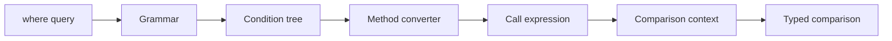

# Requirements

### Overview & Goals
Allow a provider `DbFunction` call to be an operand on either side of a `where[...]` comparison, so value-returning functions become usable without changing existing standalone predicate calls or property/value comparison behavior.

### Scope
**In scope**
- Bind `where[Reverse(x.Name)==abc]` in written operand order.
- Convert the opposite literal/property with the call result type, including comparisons such as `Similarity(x.Name, abc)>x.Float`.
- Preserve a meaningful named function-binding failure rather than interpreting an unbound call as a property path.
- Add tokenizer/parser/expression and provider integration coverage.
- Probe `select[...]` and `orderBy[...]` function-call forms and record their current independent limitations.

**Out of scope**
- Chaining members from a call result, such as `Reverse(x.Name).Length`.
- Adding function calls to `select[...]` or ordering clauses.
- Altering provider-function discovery, overload-ranking policy, or existing filter shapes.

# Technical Design

### Current Implementation
- `src/HamsterWheel.HLinq/Pipeline/Tokenizer/Grammar.cs` allows comparison tokens only after `NameOrValue`, `PropertyName`, or `Entity`; an operator following a method’s `RightCircleBracket` therefore cannot tokenize.
- `src/HamsterWheel.HLinq/Tree/Filtering/Condition.cs` constructs typed comparisons only around `Property` (or an entity) and prioritizes `IsMethod`, making a parsed method a standalone boolean condition rather than a comparison operand.
- `src/HamsterWheel.HLinq/Tree/Filtering/Method.cs` and `StaticMethodToExpressionConverter.cs` already turn a static/provider call into an `Expression`: overload resolution reports warnings/errors and its existing `InvalidStaticMethodException` names the unresolved call.
- `ArithmeticComparisonConditionBuilderContext` already owns `ComparisonType`, culture, warnings, and expression dispatch. `Property.Converter` uses it to establish the operand type before converting the opposite side.
- `ExpressionBuilder.GetSelect` requires a `MemberExpression`, and `OrderByRoot` admits property/entity children only; function calls are not currently supported by either independent clause path.

### Proposed Changes
- Expand comparison-token adjacency in `Grammar.cs` to allow a comparison after `RightCircleBracket`, following the repository rule that grammar derives syntax solely from valid token adjacency; run the existing grammar validation through tokenizer tests.
- Update `Condition.Parser`/`Method.Parser` only as required for a method call to remain a `Condition` child on either side of a comparison, preserving all existing method-parameter parsing and clause scope.
- Refactor `Condition.Converter` so the presence of a comparison controls the branch before standalone-method handling. Build whichever operand supplies type information first:
  - retain the existing property/entity paths;
  - when a `Method` is an operand, build it through its registered `Method.Converter` with `ArithmeticComparisonConditionBuilderContext`, set `ComparisonType` from the resulting `Expression.Type`, then convert the other operand through that same context;
  - support both call-left and call-right order while leaving expression comparison order unchanged.
- Do not add a property fallback for `Method`; unresolved provider calls continue through `StaticMethodToExpressionConverter` and surface the call name/position from the existing resolution path.

### Architecture Diagram

### Risks
- A call can return `bool`; comparison precedence must still permit `IsDate(...)==x.Flag` while a call without an operator remains the existing standalone predicate.
- Call-return types can be nullable or unsupported by a requested operator; retain `Condition`’s existing `ComparisonOperandTypesCannotBeComparedException` behavior after both expressions are built.
- The tokenizer change must not treat `.`/`..` or keywords specially; tests must exercise the grammar validator and existing tokenizer snapshots to protect the single-window walk.

# Testing

### Validation Approach
Use the established `ExpressionBuilderUnitTests` pattern for tokenization, parsing, and expression-tree assertions, then validate real Npgsql translation through `DbDataTests` in `test/HamsterWheel.HLinq.IntegrationTests/DbFilter.cs`.

### Key Scenarios
- A value-returning provider call on the left compares against a literal and against a property, with the result type governing conversion.
- A call on the right of a comparison preserves the written order.
- A boolean provider call can be explicitly compared with a boolean property.
- A call that does not bind returns the named static-method failure rather than an invalid property-path result.
- Existing standalone `ILike`, ordinary/reversed comparisons, and in-memory unsupported-DbFunction behavior continue to pass.
- Add query probes demonstrating that `select[Reverse(x.Name)]` and `orderBy[Distance(...)]` remain rejected by their own current appliers; do not turn those probes into feature requirements.

# Delivery Steps

### ✓ Step 1: Enable calls as comparison syntax and tree operands
`where[...]` can tokenize and parse a completed provider call immediately followed by a comparison operator.

- Update `src/HamsterWheel.HLinq/Pipeline/Tokenizer/Grammar.cs` so comparison token rules accept `RightCircleBracket` according to the existing adjacency-based grammar model.
- Adjust the relevant `Condition`/`Method` parser behavior only if needed to retain both left- and right-side calls as children of one `Condition`.
- Extend tokenizer/parser tests and grammar validation coverage for `Reverse(x.Name)==abc`, `abc==Reverse(x.Name)`, and comparison forms that preserve existing method and property grammar.

### ✓ Step 2: Build typed comparisons from provider call results
`Condition.Converter` produces a comparison expression when either operand is a resolved method call.

- Modify `src/HamsterWheel.HLinq/Tree/Filtering/Condition.cs` to prioritize explicit comparisons before standalone boolean-method handling.
- Build a `Method` operand via the registered expression converter, set `ArithmeticComparisonConditionBuilderContext.ComparisonType` from the call expression, and convert the opposing operand within that context.
- Preserve left/right expression order, existing property/entity conversion behavior, ambiguity warnings, incompatible-type exceptions, and `StaticMethodToExpressionConverter`’s named unresolved-call diagnostics.
- Add unit cases in `test/HamsterWheel.HLinq.UnitTests/Pipeline/Applier/Builders/Filter.cs` (and the NETSTANDARD dummy source if a non-boolean return fixture is needed) for value and boolean call comparisons plus failure behavior.

### ✓ Step 3: Prove provider binding and protect current clause behavior
Database-backed tests demonstrate that function-result filters bind to the configured provider and existing filters remain stable.

- Add focused Npgsql integration scenarios to `test/HamsterWheel.HLinq.IntegrationTests/DbFilter.cs` for a value-returning provider function compared with a literal/property, asserting the query result against the matching EF expression.
- Retain and run the existing whole-condition `ILike` and regular comparison cases as regression guards; preserve the attached `Filter.cs` in-memory bad-request behavior for provider calls.
- Add explicit parser/applier probes for function syntax in `select[...]` and `orderBy[...]` to establish their current rejection paths without changing those clauses.
- Validate with the repository’s defined build and unit test commands; run PostgreSQL integration tests locally when the configured database is available, otherwise rely on the CI integration job.